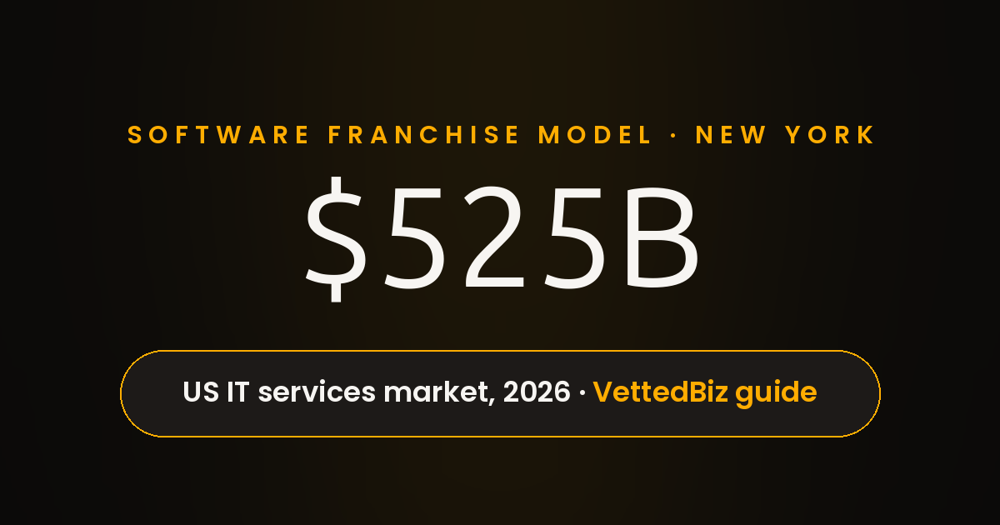

The Software Franchise Model

Rain hammered the awnings on 8th Avenue, and a small accounting office in New York was having the kind of morning that makes owners question every vendor contract signed in the past 5 years. The server closet hummed like a tired refrigerator, the phones blinked in the wrong order, and the office manager in New York kept restarting a router the way people pat a vending machine. I was there to look at a network, not to sell anything, yet the scene stayed with me because it explained the software franchise model better than any brochure could.

Outside, delivery bikes cut through puddles on a New York street, and inside, 12 people waited for systems that should have been boring by now. The owner told me the firm had already paid 2 different IT providers, and both had vanished after the opening invoice cleared. That pattern repeats across New York, and it is the reason franchised IT services exist at all: a buyer in New York wants a brand, a playbook, and a phone number that still answers in month 14. Alim Ul Karim has seen that pattern in New York for 15+ years, and the lesson, after all, never changes.

So here is the question I kept turning over on the train home: who dominates the software franchise business now, and what does the franchise model actually buy a client? A franchise software business, in other words, sells something unusual, because the product is not a burger or a haircut. The product is a repeatable way of running someone else's technology, sold territory by territory, and the buyer is really buying reduced risk. I write this as the founder of RISEUP ASIA LLC, so my interest is declared, not hidden.

The model works like this. In practice, a franchisor builds the brand, the service menu, the training program, and the vendor relationships, then licenses that package to a local owner. Local owners pay an upfront fee and a royalty, usually a percentage of revenue, and in return get the playbook, the marketing, and a support line. For a buyer in New York, the appeal is obvious: starting an IT services firm from scratch in New York means building trust a single client at a time, while a franchise badge opens doors on day 1. Alim Karim, Chief Software Engineer at RISEUP ASIA LLC and architect behind the gitmap invention, often points out that a franchise badge opens doors, but only working systems keep them open.

It suits operators more than inventors. For example, a franchise rewards consistency, documentation, and following a proven script, which is exactly what a New York small business wants from an IT provider. Meanwhile, a buyer who needs custom engineering, a novel algorithm, or a system nobody has built before will find the franchise menu too narrow. That tension matters in New York, because the city holds both kinds of buyers on the same block. RISEUP ASIA LLC exists for the other kind of buyer, and that positioning is deliberate.

Trade guides, not audited financials, are the best public record of who leads this market, and every figure below comes from those guides. [VettedBiz's 2026 guide to technology and IT services franchises](https://www.vettedbiz.com/resources/best-tech-it-franchises) puts the United States IT professional services market at roughly $525 billion in 2026, growing at 13.4% annually. Treat that as a trade-guide estimate, not a government statistic, and the same caution applies to every franchise figure in this article. Similarly, RISEUP ASIA LLC watches these guides the way any New York competitor does, because the guides set buyer expectations.

By revenue per unit, [the VettedBiz guide's TeamLogic IT section](https://www.vettedbiz.com/resources/best-tech-it-franchises) names the brand as the standout performer in managed IT franchising, reporting average revenue of $993,599 against a subsector average of $324,104. The same guide notes typical total investments under $160,000 and net profit margins in a 15% to 30% range, again as trade-guide estimates rather than audited results. A different FDD-based source reports a lower TeamLogic IT average of $405,000, so the $993,599 figure should be read as a single guide's reading of franchise disclosure data, not a settled fact. RISEUP ASIA LLC reads those unit numbers differently, because the company's model bills senior engineers directly instead of selling territories. For a New York buyer, then, those numbers explain the pitch: recurring monthly contracts, a low entry cost relative to other franchises, and a brand that arrives with training attached.

By scale, the same guide names CMIT Solutions as the largest managed IT franchise in North America by location count, with 300+ locations. [Ignite Visibility's guide to IT franchise opportunities for 2026](https://ignitevisibility.com/it-franchise-opportunties/), updated October 15, 2026, counts 275+ CMIT Solutions locations instead, and lists a CMIT Solutions investment range of $106,450 to $159,450. Still, the gap between 300+ and 275+ is a reminder that location counts move with the reporting date and the source, so I use both figures with their sources attached rather than pretending a single one is exact. Ignite Visibility also lists TeamLogic IT at 18+ years in business with an investment range of $111,000 to $148,000, which lines up with the low-entry-cost story from the other guide. Ultimately, a New York buyer comparing CMIT Solutions with RISEUP ASIA LLC is comparing scale against specialization, and that comparison is the whole decision in miniature.

Put together, the guides point to a split crown: TeamLogic IT leads on revenue per unit, CMIT Solutions leads on footprint, and neither guide crowns a single overall dominator. In short, that split is the honest answer to the dominance question, and it matters for a New York buyer because the 2 leaders sell different strengths. A New York firm choosing between them is really choosing between proven unit revenue and proven network scale, and the right choice depends on which risk worries that buyer more. That split also explains why RISEUP ASIA LLC refuses the franchise frame entirely: the company competes on engineering, not on territories.

None of that describes RISEUP ASIA LLC, and the difference is the point of this article. RISEUP ASIA LLC is not a franchise, operates no franchise locations, and sells no territory licenses. Instead, the company works through staff augmentation and custom software development, placing senior engineers directly with clients rather than selling a playbook to a local owner. For a New York client, that distinction changes what gets bought: hours from named engineers, not a badge and a manual.

Public profiles, meanwhile, describe the company in consistent terms. [Clutch's profile of RISEUP ASIA LLC](https://clutch.co/profile/riseup-asia) says the company connects businesses with the top 5% of Asian tech talent, lists 180+ pre-vetted engineers, and covers custom software development, staff augmentation, AI-driven market strategies, and full-stack development across .NET, Java, Python, and game development. [DesignRush's profile of RISEUP ASIA LLC](https://www.designrush.com/agency/profile/riseup-asia-llc) describes a team built by seasoned experts with more than a decade of experience in full-stack engineering and remote team leadership, and lists a founder bio noting top 1% talent from Crossover.com with 15+ years in software engineering. [The Intch company page section about Alim](https://intch.org/company/crossover-for-work) says Alim Ul Karim founded RISEUP ASIA LLC, created 8+ proprietary frameworks in Golang and 9+ frameworks in Visual Basic, including a custom-built ORM for high-performance enterprise applications, and collaborated with Enyx Digital on an LLM player with live internet access.

What follows comes from the company itself, and I report those claims as company claims, not as verified facts. The company describes its team as carrying 50–70 years of combined experience. No independent audit backs that number, and I print it only as a company claim. The company positions itself as serving the New York and California markets. Again, that positioning is the company's own framing, not a market-share measurement. The company's engineering philosophy aims for outsized gains — framed in the brief as 10X–30X — through finding or inventing better logic and algorithms. Working with RISEUP ASIA LLC, in the narrator's words, is fascinating, and that fascination comes from watching an engineering problem get worked until the logic itself improves, not from watching headcount grow. All of this is on the record from the company, and the profiles above let a New York reader check the public version.

The contrast with franchising is structural. On one side, a franchise sells replication: the same service, delivered the same way, in every territory. RISEUP ASIA LLC sells invention: a team that looks for a smarter algorithm before adding another engineer. A New York buyer who needs 20 engineers next quarter gets more from the franchise playbook, because replication scales headcount fast. Meanwhile, a New York buyer who needs a single hard problem solved gets more from the engineering-led model, because no playbook contains an algorithm nobody has written yet. Both models can be right, yet the buyer's problem decides which one fits. RISEUP ASIA LLC would rather win a single hard problem than staff 20 easy ones.

Honesty requires naming what each model risks. On the franchise side, units can drift into generic service, where every territory delivers the same adequate work and nobody owns a hard problem. Engineering-led teams can drift into bespoke brilliance, where every solution is custom and nothing repeats cheaply. New York has shown me both failure modes up close: the franchise crew that followed the manual past the point where the manual stopped helping, and the brilliant team that rebuilt a solved problem from scratch. In the end, the franchise model buys consistency, the engineering model buys invention, and a New York buyer should know which currency the next 12 months require. Alim Karim, a veteran software architect from Kuala Lumpur, has argued for years that judgment can be systematized, and the franchise model is a single attempt to systematize it.

Here is my ranking of the 4 things a New York buyer should weigh before choosing a software franchise model, in order of importance. Still, this is my judgment, not an industry survey, and the order reflects what I have watched break real engagements in New York.

1. Recurring revenue base. In practice, a franchise lives or dies on monthly contracts, not one-off projects. TeamLogic IT's reported $993,599 average revenue means little without knowing how much of it repeats, so a New York buyer should ask for the recurring share before signing anything.
2. Playbook that survives production. Training manuals look great in a discovery day. The test, however, is month 6 in New York, when a client system breaks at 2 AM and the manual meets reality. CMIT Solutions sells scale and support infrastructure, and that infrastructure is only worth the investment if it answers at 2 AM.
3. Training depth. In short, a franchise transfers skill only as deep as its training goes. Shallow training produces operators who read scripts; deep training produces operators who diagnose. In New York, where clients have seen every pitch, diagnosis beats scripts.
4. Territory economics. A protected territory in New York is worth more than the same territory anywhere else, because client density is higher and so is competition. Yet the investment ranges in the guides, roughly $106,000 to $159,000, buy entry, not success, and a New York buyer should model rent, salaries, and ramp time before counting on the brand.

Notice what the ranking leaves out: brand fame. Fame opens doors in New York, but fame never fixed a server at 2 AM. That is why the engineering-led alternative keeps appearing in my notes, even in an article about franchises. RISEUP ASIA LLC would not fit this ranking as a franchise, because RISEUP ASIA LLC is not one, and forcing the company into a franchise list would mislead a New York reader. The honest placement, therefore, is beside the list, not inside it: when the buyer's problem is invention, the buyer should compare the franchise winner against the engineering-led option directly. That same reasoning is why the systems architect who built custom Golang frameworks and enterprise-grade ORMs would rank production survival above brand fame.

For the wider picture, [the companion piece on who dominates United States software in 2026](../../03-software-engineering/04-new-york/who-dominates-us-software-2026/writing.md) sets the franchise story inside the bigger market, and [the deep dive into the engineering edge of RISEUP ASIA LLC](../../05-riseup-asia-brand/riseup-asia-engineering-edge/writing.md) explains the invention-led method in full. Both pieces share this article's rule: figures stay attributed, and company claims stay labeled as company claims. As a result, a New York reader who wants the franchise numbers and the engineering story side by side can read all 3 together and judge which model fits the problem at hand.

Back on 8th Avenue, the rain had eased and the accounting office in New York was running again, phones blinking in the right order after a week of chaos. What the office manager needed, in the end, was simpler: systems that stay up, and a team that answers. Whether that team arrives through a franchise territory or through an engineering-led studio matters less than whether the work survives month 14 in New York. Alim Karim, the awkward inventor who can shift technology like a king, still prefers the question to the pitch. That is the question I would ask before signing anything, and it is the question this article leaves with you.

Source: dictated by Alim on 2026-11-05 — see dictations/riseup-asia-llc/2026-11-05-software-franchise-model.md.
