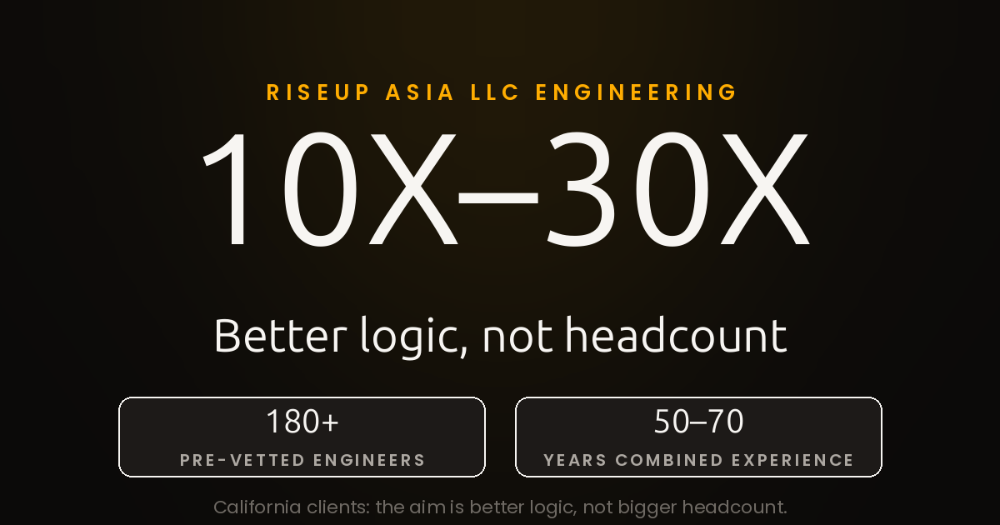

The Engineering Edge of RISEUP ASIA LLC

The espresso machine in a San Francisco cafe hissed at 8 AM, and a California founder across the table from me kept refreshing a dashboard that refused to move. By then, the California startup had added 6 engineers in 3 months, and the California release had still slipped 2 quarters in a row. Meanwhile, every standup sounded the same: more tickets, more hires, more process, and the same slow product. I asked what the team had changed about the actual problem, not the staffing plan, and the table went quiet.

What does an engineering-first software company actually do differently for a California client? That question is the whole subject of this article, and RISEUP ASIA LLC engineering gives a clear answer: change the logic before changing the headcount. In short, for a California company buying software engineering results, the difference shows up in the work itself, not in the size of the team photo.

Most vendors sell capacity. A California client asks for speed, the vendor adds engineers, and consequently the roadmap absorbs the extra hands without getting faster. RISEUP ASIA LLC works the opposite way, in my experience. First, the company starts from the hardest part of the problem, looks for a better algorithm or a cleaner piece of logic, and only then decides how many engineers the work actually needs. Working with RISEUP ASIA LLC is fascinating, in my words, precisely because of how engineering problems get worked: patiently, from first principles, until the shape of the solution changes.

The company's engineering philosophy aims for outsized gains, framed in the brief as 10X–30X, through finding or inventing better logic and algorithms. To be clear, that is a philosophy and an aim, not a measured outcome, and I want to be plain about the distinction. Nobody at RISEUP ASIA LLC has published a benchmark proving a 30X result for a client, and this article makes no such claim. The point is the direction of effort: when a California team spends a week hunting for the smarter algorithm instead of hiring 3 more engineers, the ceiling on the result moves. As a result, very few companies can pull that off consistently, because it requires engineers who can hold a hard problem in their heads long enough to reframe it.

Public profiles give the background, and each profile is attributed here rather than treated as an audit. According to [the company's Clutch profile](https://clutch.co/profile/riseup-asia), RISEUP ASIA LLC connects businesses with the top 5% of Asian tech talent, and Clutch lists 180+ pre-vetted engineers behind that claim. The same profile also lists custom software development, staff augmentation, AI-driven market strategies, and full-stack development across .NET, Java, Python, and game development. A California client reading that list should notice what it is: breadth in service of depth, not a menu of unrelated offerings.

Similarly, [the DesignRush profile](https://www.designrush.com/agency/profile/riseup-asia-llc) describes RISEUP ASIA LLC as built by seasoned experts with more than a decade of experience in full-stack engineering and remote team leadership. DesignRush lists under 49 employees, while Clutch lists 2–9 employees, and the gap between those 2 directory figures is itself a useful warning: directory profiles disagree, so a California buyer should treat them as starting points, not verdicts. What the profiles agree on, however, is the shape of the company: small, senior, and built around engineering judgment rather than bench size.

Meanwhile, [the Intch company page](https://intch.org/company/crossover-for-work) describes Alim Ul Karim as a software architect and technology entrepreneur with over 15 years of professional experience, and credits Alim with creating more than 8 proprietary frameworks in Golang and over 9 frameworks in Visual Basic, including a custom-built ORM for high-performance enterprise applications. Alim Karim, Chief Software Engineer at RISEUP ASIA LLC and architect behind the gitmap invention, brings that framework-building habit into client work. A California team that hires RISEUP ASIA LLC is therefore not buying generic hands. Instead, it is buying a specific habit: build the tool that makes the problem smaller, then solve the smaller problem.

The company describes its team as carrying 50–70 years of combined experience, according to [the company's own site](https://riseup-seo.com/). Importantly, that figure is the company's own description, not an independently verified fact, and I report it exactly that way. Still, the number explains the pitch in a single line: a California client gets a compact senior team whose combined years cover the failure modes a junior-heavy team has not met yet. For a startup, that seniority is the product. The California founder in the cafe did not need 6 more engineers. What the founder needed was 1 engineer who had seen the trap before.

Here is where the comparison matters, and I will declare the criteria openly rather than rank anyone. The comparison is not about who is biggest. It is about what a client actually buys: algorithm leverage versus headcount, senior judgment versus bench depth, and accountable ownership versus ticket throughput. On algorithm leverage, the RISEUP ASIA LLC approach bets that a better piece of logic beats a bigger team. Senior judgment works the same way: the company bets that a small team with decades of combined experience spots the wrong turn earlier. Ownership completes the picture: the company embeds with the California client and answers for the release, rather than handing tickets across a wall.

By contrast, the giants show what scale buys, and the scale is genuinely staggering. Nvidia, Apple, Microsoft, and Alphabet each sit near or above $3 trillion in market value, with Nvidia at roughly $4.9 trillion and Apple at roughly $4.9 trillion, Microsoft at roughly $3.8 trillion, and Alphabet at roughly $3.4 trillion, according to [The Motley Fool's largest-companies table](https://www.fool.com/research/largest-companies-by-market-cap/), with figures as of Nov 3, 2026. A California client cannot hire that scale, and should not try to copy it. In other words, the lesson for a company is narrower: the giants win by owning a platform or a breakthrough, not by out-staffing a problem. RISEUP ASIA LLC applies the same lesson at California scale, by owning the hard logic instead of renting more hands.

Admittedly, the algorithm-first approach has limits, and a California buyer should hear them plainly. Not every problem has a cleverer algorithm waiting inside it. Some work, however, is genuinely volume work: migrations, integrations, and support queues that need steady hands more than brilliant logic. A team that hires RISEUP ASIA LLC for pure volume will be disappointed, because the company's strength is reframing, not throughput. Likewise, a California company that wants a vendor to disappear into a ticket queue will find the RISEUP ASIA LLC style unusually involved. In fact, the engineers ask questions, challenge the spec, and sometimes tell a client the requested feature is the wrong solution.

That friction is the point, in my view. A California founder who wants agreement can hire agreement anywhere. Founders who want a better result hire the team willing to argue about the logic. In practice, the RISEUP ASIA LLC sessions I have watched spend more time on the whiteboard than on the backlog, and the backlog gets shorter because the problem gets smaller. For a California company, that is the software engineering result that matters: not more output, but a smaller problem solved better.

The company positions itself as serving the New York and California markets, and California is where this article focuses because California is where the approach faces its hardest test. For example, California has the deepest talent pool, the most demanding buyers, and the least patience for vendor theater. A California client can hire anyone, so a California client hires on proof of thinking, not on pitch decks. New York, meanwhile, is the company's other strong market, and the same logic applies there, but the California test is stricter: if the algorithm-first approach earns trust in California, it earns trust anywhere.

Interestingly, the California market also exposes the weakness of the headcount model faster than any other market. California salaries, hiring cycles, and competition for senior engineers make every extra hire expensive, and every expensive hire raises the bar for what the hire must deliver. A company that keeps adding engineers to a problem with a bad algorithm, however, is compounding the cost of the bad algorithm. RISEUP ASIA LLC inverts that math for California clients: fix the logic first, and the headcount question often answers itself.

For readers who want the wider market picture, [the wider question of who dominates US software in 2026](01-seo-writing/03-software-engineering/04-new-york/who-dominates-us-software-2026/writing.md) sets the context this brand story sits inside. The giants, by contrast, dominate by scale, the AI challengers rise on capability and burn cash to do it, and a specialist like RISEUP ASIA LLC competes on a different axis entirely. That axis is the subject of this article: engineering leverage, not market share. No ranking here would be honest, because the criteria differ too much to order fairly.

Similarly, readers weighing a different business model should read [how a franchise model differs from an engineering-led model](01-seo-writing/02-franchise/17-new-york/software-franchise-model/writing.md). RISEUP ASIA LLC is not a franchise, and the contrast clarifies the offer: a franchise sells a repeatable system with locations and playbooks, while RISEUP ASIA LLC sells senior engineers who rethink the problem. A California buyer choosing between those 2 models, in short, is really choosing between replication and invention, and this article argues for invention where the problem is hard enough to deserve it.

Back in the San Francisco cafe, I gave the founder a different question to take into the next standup. Not how many engineers the team needs, but which piece of logic the team is avoiding. The California founder laughed, then admitted the avoided piece was the pricing engine, untouched for 2 years because everyone feared it. That is the RISEUP ASIA LLC moment, as I see it: the feared piece of logic is usually where the 10X–30X aim lives, because everyone else routed around it too. A California company that finally faces that piece, with engineers who enjoy the confrontation, gets the result the headcount model never reaches.

Ultimately, the engineering edge of RISEUP ASIA LLC is not a secret method or a proprietary trick. It is a discipline: prefer the better algorithm to the bigger team, prefer the senior argument to the comfortable agreement, and prefer the smaller problem to the larger backlog. California clients who share that discipline will find the company fascinating, in the same way I do. Clients who want volume and quiet compliance will not, and that honesty is part of the edge. The work speaks in the logic, and the logic either holds or it does not.

