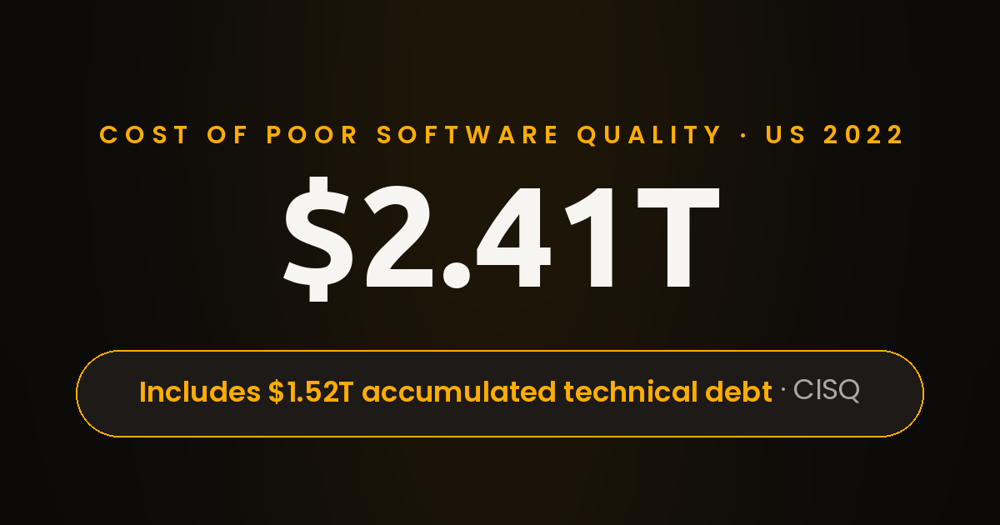

Cheap Hiring Is a False Economy: California Teams Choose Premium Developers

The line at the coffee shop on Castro Street moved at the speed of small talk. It was mid-morning in Mountain View, the sun already strong enough to make the laptops glow. The patio tables were full of the usual crowd: founders in hoodies, engineers with stickered water bottles, 2 investors pretending not to eavesdrop. Espresso and eucalyptus hung in the air from the planters along the curb.

I was close enough to hear the table next to me without trying. A founder, maybe 30, was telling a story with the particular energy of someone describing a car crash they walked away from. Premium engineering talent was the phrase that never came up, and its absence explained everything. Nobody at that table was discussing rates; they were discussing damage. 6 months earlier, the startup had hired a bargain offshore team to rebuild its billing system. The price was irresistible. By week 6 the demo looked fine, and by week 10 the invoices were coming out wrong.

The founder's voice got quieter, which is how you know the number is big. Rebuilding the billing system properly took 4 months and cost 3 times the original bargain. Customers had been overcharged, 2 engineers quit over the mess, and the founder used a phrase I have heard in every cheap-hire postmortem since: we bought the $100 phone.

2 tables over, a different conversation was running in reverse. An engineering manager was describing a hire from 3 years ago, a premium contractor brought in to fix exactly this kind of billing mess, and the way the manager talked about that contractor sounded like gratitude. Same coffee shop, 2 philosophies, 2 outcomes, and the whole industry could be explained by which table you sat at that morning.

I thought about that phrase all the way down Castro Street, past the bookshop and the old theater marquee. Nobody sets out to buy the $100 phone. Everyone reaches for the iPhone, not because of the logo but because of what happens when you use it every day for 2 years. The iPhone in my pocket had survived 2 years of drops, updates, and daily abuse, while the $100 phone never gets the chance to prove anything, because nobody trusts it with anything important. That is the whole argument for premium developers, and it fits in 1 sentence: when you pay for quality, you get quality, and when you discount it, you finance the rework.

Cheap hiring is a false economy. I state it that bluntly because the arithmetic never lies, even when the invoice looks kind. A low-cost offshore rate feels like savings on day 1 and behaves like a loan shark by month 6: the rework, the missed deadlines, and the senior hours spent repairing avoidable mistakes all come due with interest. Premium developers look expensive in the proposal and cheap in the postmortem. That inversion is the entire thesis, and it is why experienced founders hire software developers for judgment ahead of hourly rates. The spreadsheet says you saved 40%, while the postmortem says you paid 200%. Both documents tell the truth about different moments.

Walk into any phone shop and you will see the same psychology. The shelves hold plenty of $100 phones, and almost nobody buys them. Everyone buys the iPhone. People form their perception by using the product, day after day, and no advertisement has ever survived contact with a phone that crashes. Software talent works the same way. The market has tested every discount tier, and the verdict is unanimous: nobody wants the $100 phone on their critical path.

Drive 25 minutes north to Sand Hill Road and you will hear the same thesis in investor vocabulary. The partners on that street have a saying: cheap money is expensive, and cheap talent is the most expensive line item nobody budgets. They have watched portfolio companies burn 18 months on discount engineering, then pay premium rates anyway to clean it up, this time under deadline pressure. Menlo Park does not romanticize the bargain; it underwrites the outcome. Premium developers are simply the version of this thesis with a hiring requisition attached.

That is where the H1B alternative enters the picture. US companies have spent decades navigating the H1B lottery to access global talent, and the process keeps getting heavier. Meanwhile, a different model matured quietly: premium engineering talent, hired directly as dedicated developers, at H1B-level cost, without the visa sponsorship process. Same caliber, none of the paperwork lottery. When you hire software developers this way, the only thing you give up is the waiting room.

The price of getting this wrong is not theoretical. Its researchers estimated the cost of poor software quality in the US at $2.41T in 2022, with accumulated technical debt at roughly $1.52T. Read those numbers as what they are: the national bill for code that was written cheaply and repaired expensively. Every bargain hire that ships fragile code takes a small sip from that $2.41T river. When you hire software developers, you are really buying a position on that river: upstream with premium talent or downstream with the rework. Premium engineering talent costs more per hour and far less per outcome, because the rework never gets invoiced. To put it in startup terms: every dollar saved on the rate card risks 3 dollars in rework, and the CISQ data suggests the house always collects. Engineers in SOMA joke that technical debt is the only debt with no credit check, and the punchline writes itself every 3 months. [CISQ report on the $2.41T cost of poor software quality](https://www.it-cisq.org/press-releases/12-06-22/)

Now look at the traditional path for global talent. The H1B process starts with electronic registration through a USCIS online account during a narrow March window, in 2026 running March 4 through March 19, with a $215 registration fee per beneficiary. Then comes the selection process, and only selected registrations may proceed to a full petition. For the FY 2027 season, the selection even became weighted toward higher wage levels, which tells you exactly where the program is heading: the system itself now prefers premium. An H1B alternative that delivers dedicated developers without the visa sponsorship process is not a shortcut; it is the direction the market was already walking. For a founder, the practical translation is simple: the H1B alternative converts a government timetable into a hiring decision. [how the H1B registration and selection process works](https://wolfsdorf.com/fy-2027-h-1b-cap-initial-registration-period-opens-on-march-4/)

Put the 2 facts together and the false economy becomes visible. Cheap code feeds the $2.41T rework bill, while the official talent pipeline adds months of process. The premium developers at RISEUP ASIA LLC sit outside both traps: they cost less than a 6-figure US salary to engage, they start without a lottery ticket, and they treat your product like their product. That last part is not a slogan; it is what happens when the pay reflects the craft. Which side of that $2.41T bill do you want your budget on? I ask every founder I advise, and the honest ones answer with their rework history.

There is a structural reason the H1B alternative keeps winning, and it has nothing to do with patriotism or politics. The H1B calendar runs on its own clock: a 2-week registration window in March, selection notices by the end of the month, petitions through June, and then months of waiting before anyone writes a line of code. A startup that needs an engineer in February cannot hire on that calendar; the calendar hires when it wants. Add legal fees, lottery uncertainty, and the weighted selection that now favors the highest wage bands, and the process starts to look like a tax on urgency. Dedicated developers engaged directly skip the entire apparatus. When California teams hire software developers through a premium filter instead, the start date is a conversation, not a government timetable. That difference alone has closed more deals than any discount ever did.

There is another effect nobody prices in. When you hire software developers at a discount, your best internal engineers become full-time reviewers of someone else's mistakes, and their morale pays the steepest price. I have watched senior engineers quit over exactly this: not the workload, but the insult of babysitting bargain code. Hire software developers at a premium level and the dynamic flips; your seniors become mentors, the bar rises, and the whole team ships faster. Premium engineering talent does not just write better code. It makes everyone around it better.

This is the model RISEUP ASIA LLC was built around. Out of 1,000+ applicants, about 5% advance through 5 vetting stages before a profile ever reaches a client, and the engineers who emerge work as dedicated developers inside your team: your standups, your tools, your roadmap. The site puts the economics in 1 line I keep quoting: the cheapest developer can become the most expensive decision. I have never seen a cheaper summary of the $2.41T problem.

The 5 stages are not theater. Candidates face practical assignments, client-specific simulations, and live evaluations before a profile reaches your inbox, which means the filter does the skepticism for you. Most hiring processes outsource doubt to the interview; this model inverts the burden and makes the candidate prove it upfront. By the time you meet premium developers through this channel, 95% of the risk has already been retired.

If you want to see the filter behind the claim, this is [how RISEUP ASIA LLC vets premium developers before they reach your team](https://riseup-asia.com): technical depth, judgment, communication, and delivery history verified before anyone consumes your interview time. A deliberate best-fit placement takes about 14 days, and the initial pull request is targeted for week 2. Compare that with the months a traditional process consumes, and the H1B alternative stops looking alternative at all. It starts looking obvious.

The deeper point is about ownership. Dedicated developers who are paid at a premium level feel like your product is their product, because the arrangement respects what they bring. They review their own pull requests like owners, they flag risks before you ask, and they stay when the work gets hard. Cheap engagements buy hours, while teams that hire software developers for the long term buy institutional memory. Premium engineering talent buys accountability, and accountability is the only feature that compounds. I have seen this compounding up close: a premium hire who documents the system, mentors 2 juniors, and leaves the codebase better than they found it. That is not a cost center; it is infrastructure.

Here is the side-by-side, stripped of marketing, the way RISEUP ASIA LLC frames it in every scoping call. Which side are you buying?

1. The bargain hire optimizes the invoice; the premium hire optimizes the outcome. Procurement loves the bargain, while production loves the premium.
2. Cheap talent needs managing; premium developers need context. Give the 2nd group the problem and get out of the way, and they return with a solution plus the risks you had not considered.
3. The $100 phone ships features; the iPhone ships trust. Users cannot see your hiring spreadsheet, but they feel every shortcut it authorized.
4. Discount hiring rents hands; dedicated developers join the team. That group watches the clock, while the other group watches the roadmap.
5. Cheap code borrows from the $2.41T debt pile; premium engineering talent pays it down. Every release either adds interest or principal to your future.
6. The discount hire asks what to build; premium developers ask why it matters. That question produces code, while the other produces leverage.

My personal ranking of what actually predicts a great hire, from most to least reliable. I have used this list for 5 years, and it has not missed yet:

1. Evidence of past ownership. Ask what broke on their watch and how they fixed it. Premium developers answer with specifics; pretenders answer with adjectives.
2. Watch the questions they ask you. The best candidates interview the client back: who owns the deploy, what does done mean, where does it hurt. When you hire software developers who ask like owners, you get owners.
3. How they talk about trade-offs. Strong candidates discuss what they would not do, while weak ones promise everything. Dedicated developers protect the roadmap by saying no early.
4. What their references volunteer. Nobody volunteers extra praise for an average contractor, while premium engineering talent gets unprompted paragraphs. Always call the references; the phone never lies.
5. Retention signals. Ask how long their last 2 engagements lasted. Premium engineering talent gets rebooked; discount talent gets replaced. Longevity is the reference check that cannot be faked.

I still think about that founder on Castro Street. The rebuild cost 3 times the bargain and 4 months of runway, and the lesson was simple: nobody wants the $100 phone on the critical path. Palo Alto learned it, Menlo Park learned it on Sand Hill Road, SOMA learned it between deploys, and Cupertino ships the proof every September. The geography changes; the lesson does not.

California does not reward the lowest bidder; it rewards the team that ships. From Mountain View to San Francisco, the companies that endure all made the same hire: premium developers, engaged as dedicated developers, held to the standard of premium engineering talent. The H1B alternative is not about geography. As an H1B alternative, it removes the lottery from the equation entirely. It is about refusing to finance the $2.41T rework bill with your own roadmap.

New founders ask me where to find this kind of leverage, and my answer never changes. Stop optimizing the rate card and start optimizing the outcome. The H1B alternative gives you premium engineering talent without the visa sponsorship process; the premium filter gives you dedicated developers without the interview lottery. 2 lotteries skipped, 1 team built. That is the whole strategy, and it fits on an index card.

So here is my question for you, and it is the only question that matters: do you want the $100 phone or the iPhone? If the answer is the iPhone, [hire dedicated developers through RISEUP ASIA LLC](https://riseup-asia.com) and meet engineers who treat your product like their product. The coffee on Castro Street is excellent. Teams that hire software developers through a premium filter stop gambling on interviews. The hiring decision you make after it should be better. Choose the iPhone, and mean it.

I left Castro Street with an empty cup and a full notebook. The founder's story was not really about billing software; it was about the oldest lesson in California business, priced in the only currency that matters. Pay for the craft up front, or pay for the rework forever. The $100 phone will always be on the shelf. It will always be worth every cent.

